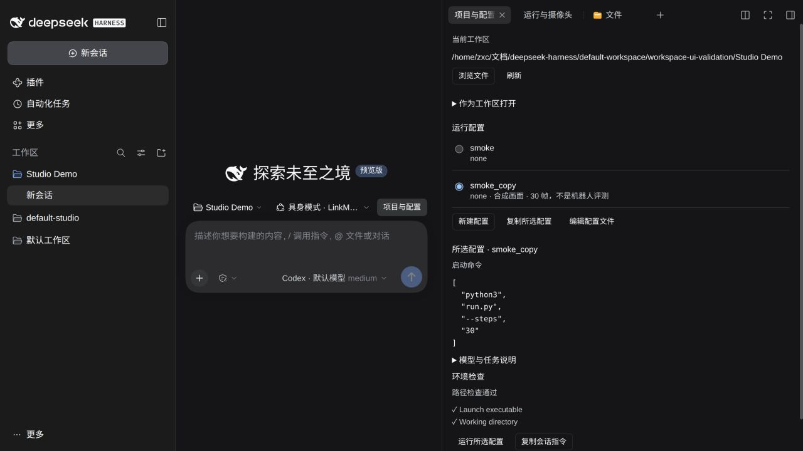

# LinkMind Studio for DeepSeek Harness

**非官方社区插件，由社区成员独立开发和维护，未经过 DeepSeek 官方审核或背书。**

在 DSH 原生会话中打开、查看、修改和运行具身项目。选择 **具身模式 · LinkMind**，保留原来的聊天、模型选择、文件浏览和工作区体验，在右侧查看运行配置、程序输出与摄像头画面。

这是基础工作台的开发预览 `0.4.0`，当前验证环境为 **Linux x64 + DSH 0.2.2-rc.2**。它不是新的控制算法，也不自动完成任意仓库的复现。可视化动效、经验系统、RSI 与自动基础设施选择不包含在本版本中。

## 界面




## 能做什么

- **选择工作区**：使用默认 `~/LinkMind Studio`，或直接选择已有 HexaShell、LinkMind 等本地仓库。文件保留在原目录。
- **查看与编辑配置**：自动列出根目录 `linkmind.studio.json` 中的配置，支持新建、复制和 JSON 编辑；可以用 DSH 文件树查看 README 和源码。
- **两种启动入口**：选择配置后直接运行，或复制一条指明配置的自然语言指令，粘贴到原生会话发送。
- **观察执行**：增量显示程序输出，展示程序发布的摄像头快照，查看历史记录、原始 JSON 结果并停止子进程。
- **保留复现线索**：每次运行单独保存命令、配置、Git 提交、工作区差异、日志和结果路径。

对话中的模型负责协助开发；外部方案实际使用哪个模型、场景和预算，由它自己的启动命令与配置决定。选择 GPT 作为会话模型不会自动改写项目模型。

## 安装

需要 Linux、Python 3.11+（含 `venv`）、Git，以及 DSH **0.2.2-rc.2**。已有的 DSH 登录和默认模型继续使用。Linux 桌面发行版可使用 [dsh-linux](https://github.com/zhanxch/dsh-linux)。

先准备独立的 Python MCP 环境：

```bash
git clone https://github.com/zhanxch/deepseek-harness-LinkMind.git
cd deepseek-harness-LinkMind
python3 -m venv "$HOME/.local/share/linkmind-studio/python"
"$HOME/.local/share/linkmind-studio/python/bin/python" -m pip install -r requirements.txt
```

然后通过 DSH 自带的插件管理器安装此仓库目录：

> 安装 LinkMind Studio 插件：用 plugin_manager 的 install_bundle，target 传刚下载的 deepseek-harness-LinkMind 目录的绝对路径。安装后彻底退出并重新打开 DSH。

也可以在完全退出 DSH 后使用它的 CLI，**profile 和 DSH_HOME 必须对应平时使用的应用**：

```bash
# 普通 dsh web 用户的 web profile
npm pack --ignore-scripts
dsh plugin --profile web add ./linkmind-dsh-studio-0.4.0.tgz --ignore-scripts
```

`zhanxch/dsh-linux` 桌面版使用 `desktop` profile，默认数据目录为 `~/.dsh`。可运行本仓库的安装器（需要 Node.js 24.9+ 和 npm）：

```bash
node install-desktop.mjs
# 使用自定义数据目录时，例如本机便携启动器：
# node install-desktop.mjs --home "$HOME/.local/share/dsh-linux/home"
```

重新打开 **DeepSeek Harness**，新建会话，模式菜单选 **具身模式 · LinkMind**。默认无需配置 LinkMind 源码路径，也无需仿真器。插件设置中的 `python` 可指定另一 MCP Python 环境；默认使用上面创建的解释器。

## 第一次使用

1. 在工作区和模式选择旁点击 **项目与配置**。
2. 展开 **作为工作区打开**：选 **默认 Studio 工作区**，或者浏览并选择自己的项目目录。这个目录会加入 DSH 左侧的工作区列表。
3. 已有配置会自动列出。选择一项可查看启动命令、模型/任务说明和文件检查结果。
4. **浏览文件**打开原生文件树；**新建配置 / 复制所选配置 / 编辑配置文件**修改启动 JSON。保存后可以运行。
5. 点击 **运行所选配置**，右侧自动打开 **运行与摄像头**。也可以复制会话指令，让助手启动同一份配置。

没有 GPU 或仿真器也能测试：将本仓库 `examples/studio-project` 作为工作区打开，选 `smoke`，点击运行。它只用 Python 标准库，运行约 8 秒，输出日志、移动蓝点的合成 PNG 和 JSON 结果；不会调用模型或机器人。

让助手准备已有项目时可以说：

> 阅读当前工作区的 README 和运行入口，把已验证的启动命令保存为 linkmind.studio.json。保留原方案的模型、场景和预算，说明缺少的依赖。不要重新实现控制算法。

配置示例：

```json
{
  "version": 1,
  "recipes": {
    "original": {
      "argv": ["{project}/.venv/bin/python", "run.py", "--output", "{output}"],
      "cwd": ".",
      "timeout_seconds": 5400,
      "result": "result.json",
      "cameras": {"head": "live/head.png"},
      "metadata": {"model": "实际使用的模型", "task": "任务与场景"}
    }
  }
}
```

示例字段必须对应项目真实入口。`argv` 是参数数组，`cameras` 和 `result` 是本次输出目录下的相对路径；未提供的输出可以省略。每次运行都有新的 `{output}`，也通过环境变量 `LINKMIND_RUN_OUTPUT` 传入。不要在配置中写密码或 API Key。更多协议与比较方法见 [项目指南](docs/projects.md)。

## 当前边界

- 已在 Linux 上验证；进程管理使用 `/proc` 和 Linux 子进程监督机制，未支持 Windows/macOS。
- 运行配置有相应用户权限，可以执行本地程序。导入仓库后仍需查看命令并准备它的环境、权重和资产；文件检查通过不等于复现成功。
- 外部方案独立执行。会话中途发送的消息会到达 DSH 助手，**不会自动注入外部控制策略**。中途策略引导需要该方案提供适配接口。
- 摄像头来自程序发布的 PNG/JPEG 快照，更新频率取决于原程序；它不是 USB 摄像头采集器或固定帧率视频流。界面显示最新画面的时间。
- 同时只运行一个项目或仿真；停止按钮结束进程，并非实体机器人的急停。
- 源码追溯记录 Git HEAD、tracked diff 和未跟踪文件的哈希，不打包权重、被忽略资产或完整环境。退出码 0 也不等于任务成功。
- 配置编辑器保护未保存草稿和并发修改；它是启动 JSON 编辑器，源码查看仍使用 DSH 原生文件功能。

若需要 DSH 会话直接控制 LinkMind 内置仿真，可在设置中指定另行配置好的完整 [LinkMind Studio 开发分支](https://github.com/zhanxch/LinkMind/tree/feat/dsh-embodied-studio) checkout（`root`）及 Python。目前该集成仍在开发分支，不能直接使用 LinkMind 的 `main` 代替。该可选路线需要仿真资产和依赖，详见[上游 Studio 文档](https://github.com/zhanxch/LinkMind/blob/feat/dsh-embodied-studio/docs/studio-projects.md)。`codex` 设置也是可选的实验适配器，默认关闭，不改变 DSH 默认模型。

## 开发与验证

```bash
PYTHONPATH=backend/src python3 -m unittest discover -s tests -q
node --check client.js
npm pack --dry-run --ignore-scripts
```

独立包的来源和文件哈希记录在 [SOURCE.json](SOURCE.json)。界面验证使用真实 DSH 的隔离预览 profile；桌面宿主协议另行验证。截图中的蓝点是合成自检，原生 Push-T 的开发运行不代表这个插件的算法优势或跨平台验证。

MIT license. 使用 DSH 的 `agentPresets`、会话工具钩子、MCP、`conversation.hero.options`、原生工作区及右侧栏插件扩展点；没有修改 DSH 聊天实现。HALOFLUX 的源码、美术和动效未包含在此仓库。
