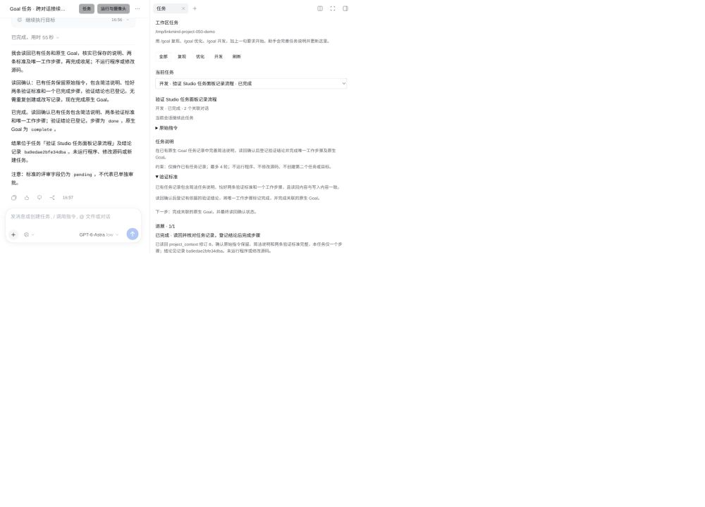
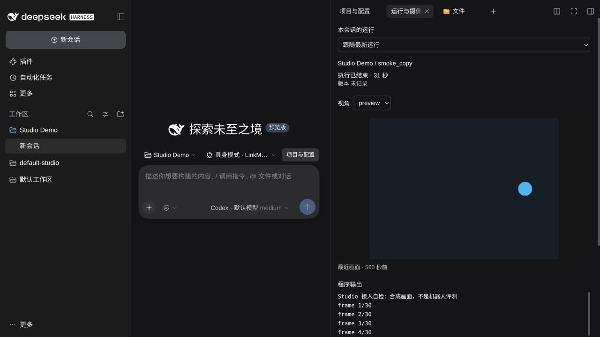

# LinkMind Studio for DeepSeek Harness

**非官方社区插件，由社区成员独立开发和维护，未经过 DeepSeek 官方审核或背书。**

在 DSH 原生会话中开发具身项目：选工作区，选 **具身模式 · LinkMind**，直接说要做什么。需要持续推进时输入 **`/goal 复现|优化|开发` + 要求**，使用 DSH 自带的目标状态、暂停、恢复和续行。助手结合你的指令和仓库完善任务说明、步骤和验证标准，任务面板保存进展、证据及关联对话；运行侧栏显示日志与摄像头。

这是开发预览 `0.6.0`，当前验证环境为 **Linux x64 + DSH 0.2.2-rc.2**。它不是新的控制算法，也不自动完成任意仓库的复现。

## 界面





## 能做什么

- **从一句话开始**：`/goal 复现 当前仓库的 Push-T，保留原模型、场景和预算`。三种任务明确区分，无需新建项目卡或填写验收表。
- **会话协作**：使用原生流式回复和插话；通过 `/goal` 查看目标，`/goal edit 新目标` 调整，`/goal pause` 暂停，`/goal resume` 恢复。普通消息也可以直接启动一次测试。
- **任务可视化与接续**：面板展示原始指令、任务说明、验证标准、步骤、决定、证据与关联运行。在同一工作区的新会话点击 **在此会话接续**，读取同一任务，不复制一份进度。
- **打开原有代码库**：使用 DSH 工作区选择器和文件树；配置保存在普通项目文件中，由助手准备，也可以自己编辑。
- **观察执行**：增量显示程序输出、摄像头快照和原始结果；运行历史保留命令、配置、Git 提交、差异和日志。

对话中的模型负责协助开发；外部方案实际使用哪个模型、场景和预算，由它自己的启动命令与配置决定。选择 GPT 作为会话模型不会自动改写项目模型。

## 安装

需要 Linux、Python 3.11+（含 `venv`）、Git，以及 DSH **0.2.2-rc.2**。已有的 DSH 登录和默认模型继续使用。Linux 桌面发行版可使用 [dsh-linux](https://github.com/zhanxch/dsh-linux)。

先准备独立的 Python MCP 环境：

```bash
git clone https://github.com/zhanxch/deepseek-harness-LinkMind.git
cd deepseek-harness-LinkMind
python3 -m venv "$HOME/.local/share/linkmind-studio/python"
"$HOME/.local/share/linkmind-studio/python/bin/python" -m pip install -r requirements.txt
```

然后通过 DSH 自带的插件管理器安装此仓库目录：

> 安装 LinkMind Studio 插件：用 plugin_manager 的 install_bundle，target 传刚下载的 deepseek-harness-LinkMind 目录的绝对路径。安装后彻底退出并重新打开 DSH。

也可以在完全退出 DSH 后使用它的 CLI，**profile 和 DSH_HOME 必须对应平时使用的应用**：

```bash
# 普通 dsh web 用户的 web profile
npm pack --ignore-scripts
dsh plugin --profile web add ./linkmind-dsh-studio-0.6.0.tgz --ignore-scripts
```

`zhanxch/dsh-linux` 桌面版使用 `desktop` profile，默认数据目录为 `~/.dsh`。可运行本仓库的安装器（需要 Node.js 24.9+ 和 npm）：

```bash
node install-desktop.mjs
# 使用自定义数据目录时，例如本机便携启动器：
# node install-desktop.mjs --home "$HOME/.local/share/dsh-linux/home"
```

重新打开 **DeepSeek Harness**，新建会话，模式菜单选 **具身模式 · LinkMind**。默认无需配置 LinkMind 源码路径，也无需仿真器。插件设置中的 `python` 可指定另一 MCP Python 环境；默认使用上面创建的解释器。

## 第一次使用

1. 用 DSH 原生 **工作区** 选择器打开本地仓库，模式选 **具身模式 · LinkMind**，照常选择会话模型。
2. 在输入框键入 `/`，选择 **goal**，再写想完成的事情。例如：

   ```text
   /goal 复现 当前仓库的 Push-T。保持原方案的模型、场景和预算，检查环境、运行并核对原始结果。
   ```

3. 助手先从指令完善任务说明、约束、验证标准与必要步骤，原始要求一直保留。点击 **任务** 查看；正常对话即可补充或纠正，`/goal edit 新要求` 可直接更新目标。
4. 要优化已有方案，用 `/goal 优化 ...`，保留基线并比较改动；要实现新功能，用 `/goal 开发 ...`，围绕使用场景实现并验证。
5. 运行后点击 **运行与摄像头** 查看画面与日志。需要检查配置时，在文件侧栏点击 **运行配置**，或通过右侧栏添加该页签；它是可选工具。

输入 `/goal` 查看当前目标；`/goal pause` 暂停续行；`/goal resume` 恢复；`/goal clear` 清除当前目标。**暂停目标不会停止已经启动的外部程序**，停止程序请使用运行侧栏的停止按钮。目标在原会话中持久保存，重启后需恢复续行。

只跑一次无需 Goal。例如：

> 使用当前项目已有的 hexashell 配置启动一次 Push-T，保持原模型、场景和预算。告诉我运行状态和如何查看摄像头。

没有 GPU 或仿真器也能测试：将本仓库 `examples/studio-project` 作为工作区打开，说“运行 smoke 配置”。它只用 Python 标准库，约 8 秒，输出移动蓝点的合成 PNG、日志和 JSON；不调用模型或机器人。

## 可选的启动配置

配置是给程序保存启动参数的普通文件，不是开展对话的前置条件。已有配置可复用；没有配置时让助手读 README 和运行入口后准备，也可以在文件侧栏的 **运行配置** 中新建、复制和修改。

配置示例：

```json
{
  "version": 1,
  "recipes": {
    "original": {
      "argv": ["{project}/.venv/bin/python", "run.py", "--output", "{output}"],
      "cwd": ".",
      "timeout_seconds": 5400,
      "result": "result.json",
      "cameras": {"head": "live/head.png"},
      "metadata": {"model": "实际使用的模型", "task": "任务与场景"}
    }
  }
}
```

示例字段必须对应项目真实入口。`argv` 是参数数组，`cameras` 和 `result` 是本次输出目录下的相对路径；未提供的输出可以省略。每次运行都有新的 `{output}`，也通过环境变量 `LINKMIND_RUN_OUTPUT` 传入。不要在配置中写密码或 API Key。更多协议与比较方法见 [项目指南](docs/projects.md)。

## 跨对话接续

任务记录属于当前工作区，原生 Goal 属于执行它的会话。在新会话选择同一工作区和具身模式，点击 **任务**，选择已有任务并点击 **在此会话接续**。也可输入 `/goal tasks` 查看列表，再用 `/goal continue <任务编号>` 接续。助手会得到之前完善的说明、进展、证据和下一步。

同一任务一次由一个会话执行。原会话还在运行时，接续会提示先暂停并等本轮结束；转移成功后旧 Goal 暂停，旧会话不能继续改写该任务。新会话已有未完成目标时，先 `/goal clear` 收起当前目标；其共享任务记录仍保留。

`/goal pause` 只暂停续行，`/goal clear` 只解绑当前 Goal；它们都不会删除共享任务或停止外部程序。结束程序请使用运行侧栏。完成状态来自助手的原生 Goal 报告，面板同时保留结论和原始证据，不把进程退出视为成功。

`0.5.0` 的手工项目表单已移除，旧目标与修订仍可通过 `project_context` 查询，没有删除或自动转换。新版任务同样保存在插件 state 的 `project-book.sqlite3`。退出 DSH 后备份整个 state 即可保留任务记录；只复制 Git 仓库不会复制本机任务库。

## 当前边界

- 原生 Goal 使用 DSH 的同会话续行与轮次限制；它不是常驻后台服务、预算强制执行器或定时任务。关闭 DSH 会停止执行，重启后需要 `/goal resume`。
- 任务接续覆盖同一个本地工作区；目前没有跨设备同步或多会话并行执行同一任务。对话关联保留，换目录不会自动合并任务。
- 任务说明、步骤和证据由会话模型维护，质量取决于模型和实际验证。没有固定四步流程，也不会替你编造未知的实验协议。
- 已在 Linux 上验证；进程管理使用 `/proc` 和 Linux 子进程监督机制，未支持 Windows/macOS。
- 运行配置有相应用户权限，可以执行本地程序。导入仓库后仍需查看命令并准备它的环境、权重和资产；文件检查通过不等于复现成功。
- 外部方案独立执行。会话中途发送的消息会到达 DSH 助手，**不会自动注入外部控制策略**。中途策略引导需要该方案提供适配接口。
- 摄像头来自程序发布的 PNG/JPEG 快照，更新频率取决于原程序；它不是 USB 摄像头采集器或固定帧率视频流。界面显示最新画面的时间。
- 同时只运行一个项目或仿真；停止按钮结束进程，并非实体机器人的急停。
- 源码追溯记录 Git HEAD、tracked diff 和未跟踪文件的哈希，不打包权重、被忽略资产或完整环境。退出码 0 也不等于任务成功。
- 配置编辑器保护未保存草稿和并发修改；它是启动 JSON 编辑器，源码查看仍使用 DSH 原生文件功能。

若需要 DSH 会话直接控制 LinkMind 内置仿真，可在设置中指定另行配置好的完整 [LinkMind Studio 开发分支](https://github.com/zhanxch/LinkMind/tree/feat/dsh-embodied-studio) checkout（`root`）及 Python。目前该集成仍在开发分支，不能直接使用 LinkMind 的 `main` 代替。该可选路线需要仿真资产和依赖，详见[上游 Studio 文档](https://github.com/zhanxch/LinkMind/blob/feat/dsh-embodied-studio/docs/studio-projects.md)。`codex` 设置也是可选的实验适配器，默认关闭，不改变 DSH 默认模型。该适配器在已有会话中切换模型可能受上下文压缩限制；可以新建会话、选择模型，再接续同一任务。

## 开发与验证

```bash
PYTHONPATH=backend/src python3 -m unittest discover -s tests -q
node --check client.js && node --check goal.mjs
npm pack --dry-run --ignore-scripts
```

独立包的来源和文件哈希记录在 [SOURCE.json](SOURCE.json)。界面验证使用真实 DSH 的隔离预览 profile；桌面宿主协议另行验证。截图中的蓝点是合成自检，任务面板使用实际会话的功能验证记录；原生 Push-T 的开发运行不代表这个插件的算法优势或跨平台验证。具体检查与边界见 [0.6.0 验证记录](docs/validation-0.6.0.md)。

MIT license. 使用 DSH 的 `agentPresets`、会话工具钩子、MCP、`conversation.hero.options`、原生工作区及右侧栏插件扩展点；没有修改 DSH 聊天实现。HALOFLUX 的源码、美术和动效未包含在此仓库。
