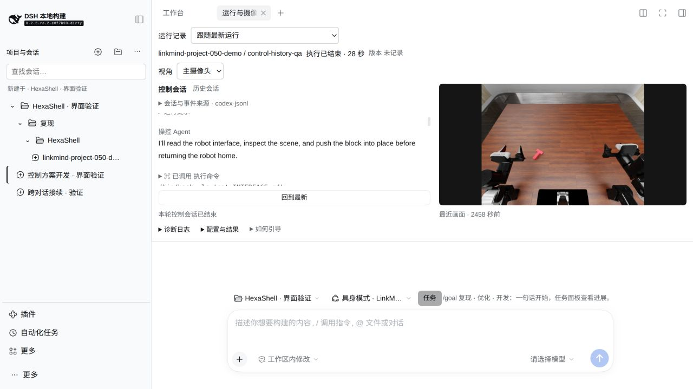
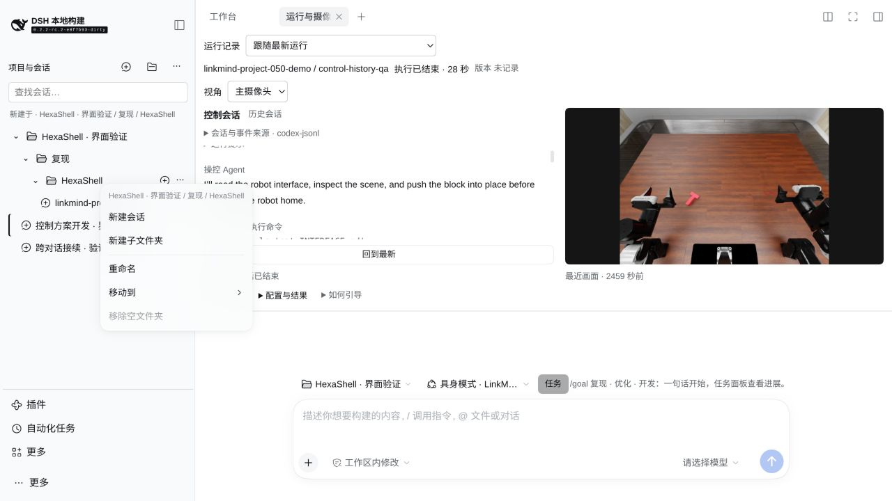

# 0.7.0 验证记录

日期：2026-11-15。环境：Linux x64，DSH 0.2.2-rc.2，本地桌面版与独立 Web 验证 profile。

## 项目与会话

- 浏览器实际右键项目创建文件夹，再右键文件夹新建会话；名称在树中原位输入。
- 交叉项目验证：下方原会话属于 `Studio Demo`，在 `default-studio / 修复` 中创建的新会话实际绑定 `default-studio`，原生工作区选择器、输入框和模型选择可用。
- F2 重命名、移动到项目根目录、刷新后保存；在同项目目录中继续创建独立会话。
- 会话归档后从活跃列表消失，归档视图可恢复；恢复后原分类和工作区仍在。
- 后端验证跨工作区归类拒绝、目录环拒绝、并发版本冲突、同级重名、空文件夹移除约束，以及旧版混合分类按工作区迁移且保留未知归属记录。
- 左侧原生工作区是代码目录；分类文件夹只组织会话，不修改 cwd、代码或会话谱系。

## 控制会话

从已有 HexaShell 和 OpenRSI HexaShell 运行输出直接读取原始 JSONL，分别得到 34、48 个结构化事件；工具开始与完成对应同一工具 ID，而非重复的独立调用。线程 ID、Agent 消息、命令和工具输出均来自原文件。

独立验证 profile 用已有 HexaShell 事件做渐进重放，实际观察到“正在调用”更新为“已调用”，并能展开原始工具返回。摄像头使用该历史运行的一张快照，明确标为历史查看；没有启动新的模型或机器人实验，也不主张画面与每条事件逐帧同步。

外部 HexaShell 本次接入仅查看。下方是正常 DSH 会话，支持其原生交互；没有把下方消息注入外部控制进程。CLI 在消息完成时才提供文本的情况，不声称为 token 级流式。

## 自动检查与安装

- `PYTHONPATH=backend/src python3 -m unittest discover -s tests -q`：32 项通过。
- `node --check`：workbench、client、index、runtime、goal、preset 通过。
- `npm pack --dry-run --ignore-scripts`：包包含工作台模块和新增 Python 模块。
- 在独立 profile 和本机桌面 profile 通过 DSH 原生 bundle manager 安装。桌面原有 6 个会话保留，账号凭据与模型/插件配置文件哈希不变。
- 上下分隔线可拖动与键盘调整；上方最大化比例仍为下方保留可用输入空间，空会话大标题在上下布局中收起。

截图为实际安装包的界面验证状态：

